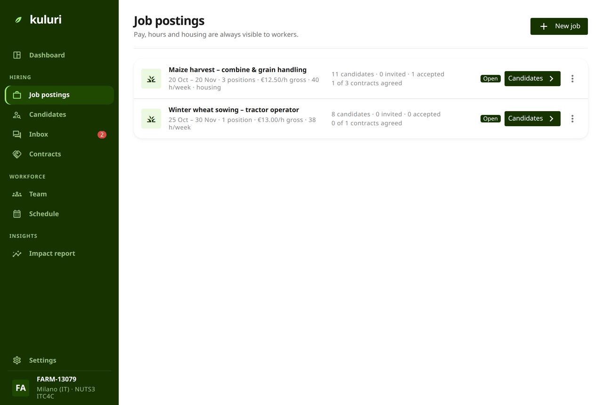
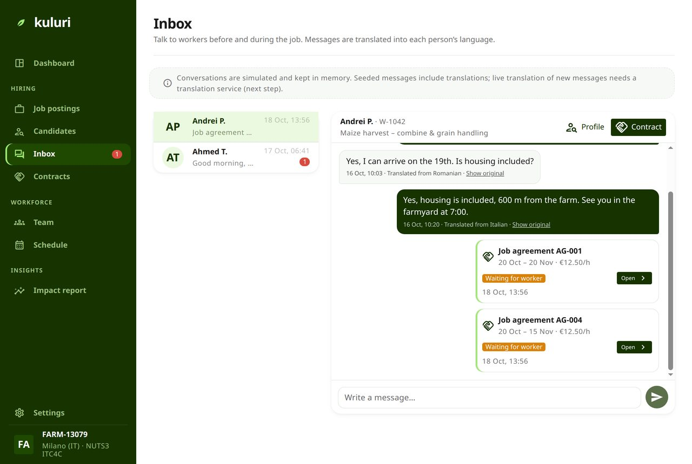
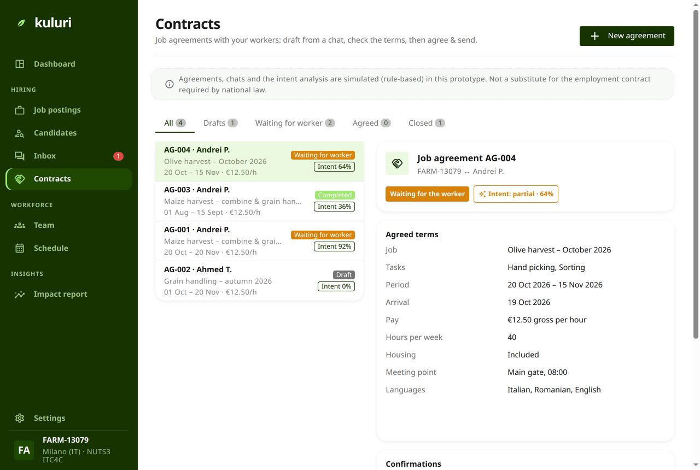
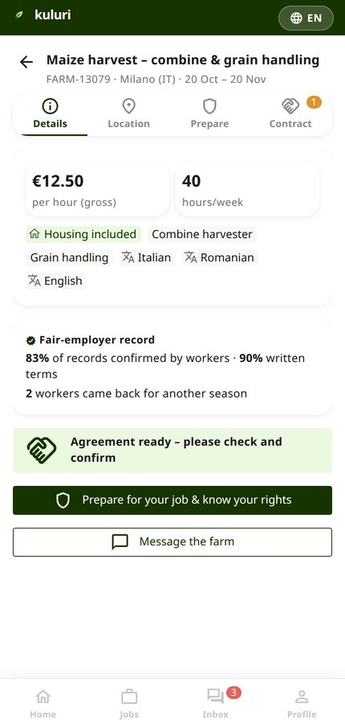
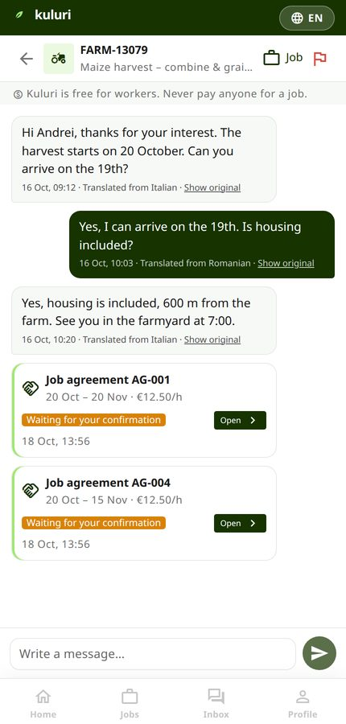
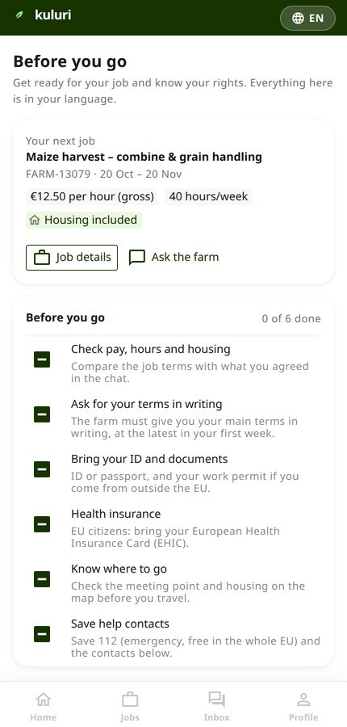
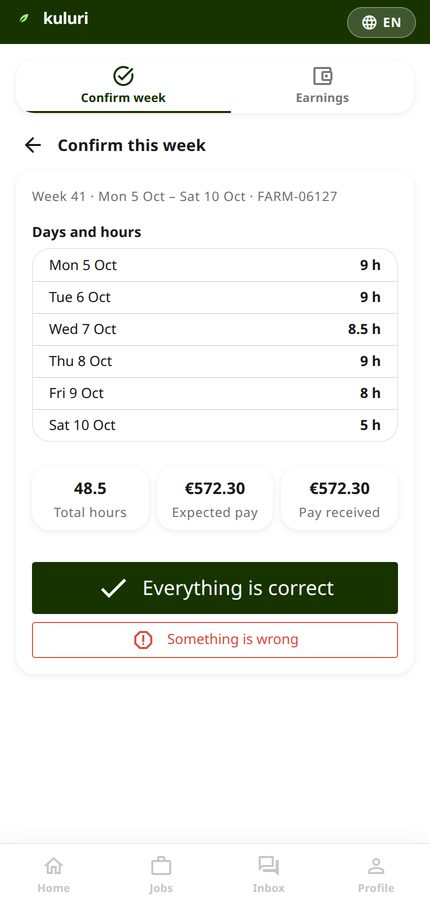
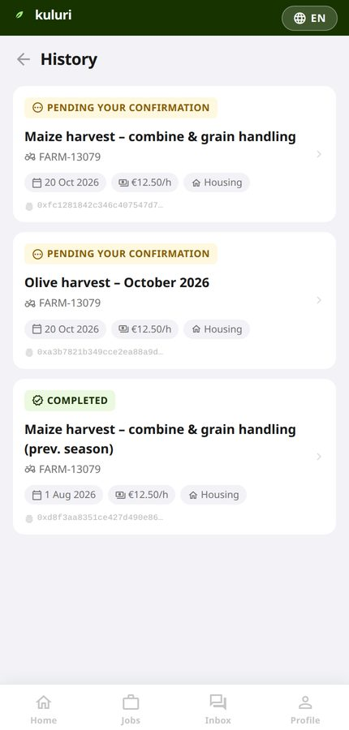
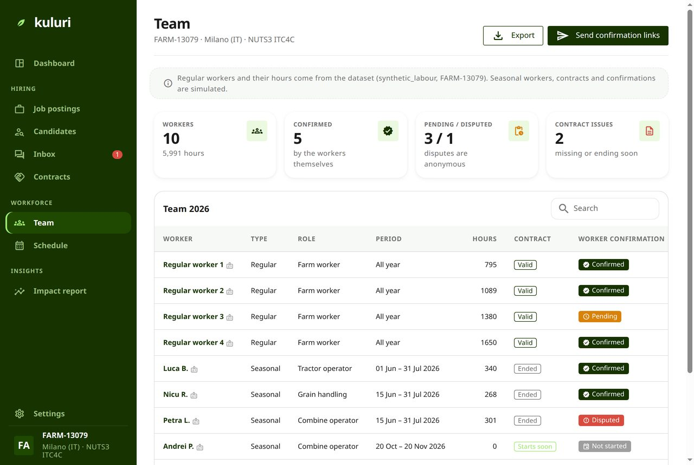
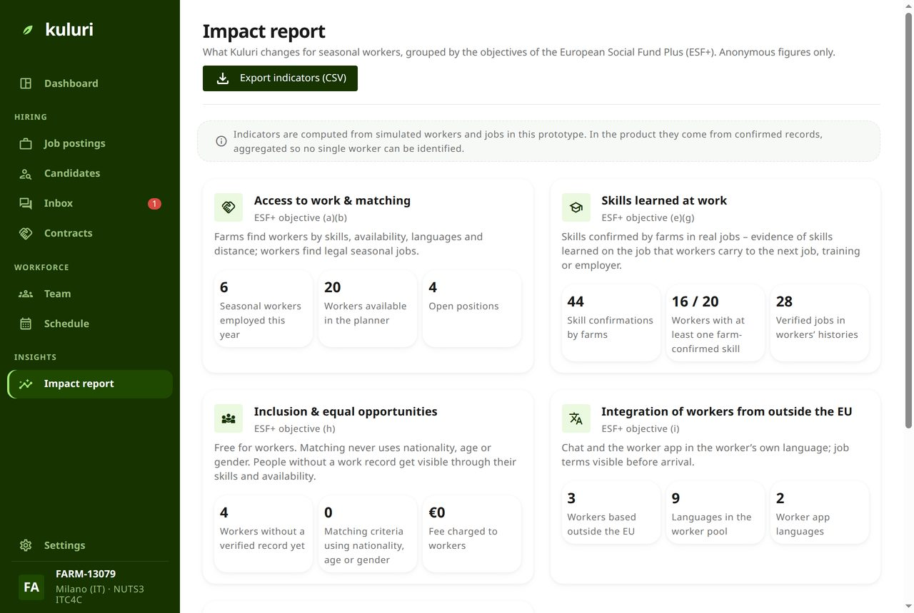

**Record once, share with control.**

Team 27 – Kuluri, EU Agri-Hackathon 2026, Challenge 3 "Flowing data, empowered collaboration".

<strong><a href="demo/">Open the working demo →</a></strong> 
No sign-up: any email address and any code will let you in. Choose <strong>Farm employer</strong>
to follow Maria's side of this story, <strong>Seasonal worker</strong> to follow Nikos's.

---

## Maria needs four pickers in two weeks

Maria grows organic olives in the Kastelli valley, in Crete. Some of her trees are more than a hundred years old. The harvest starts when it starts, and when it does she needs four people who know how to pick without bruising the fruit — within two weeks, every year.

She finds them the way most growers do: word of mouth, a cousin's phone number, a group chat, someone who turns up at the gate. Nikos, 35, has picked olives for eleven seasons. Last year he worked three days he was never paid for, and he has nothing to show any of it.

Then the buyer asks Maria to prove her workers were hired fairly, because since 2025 her CAP payment depends on it. She has a shoebox of paper, and nothing she can send.

**There are 95,000 olive-growing families in Crete, and more than 10,000 workers missing from the harvest each year.** This is what Kuluri is for.

> **About these screenshots.** They are the real app, not mock-ups. The working demo runs on the farm the organisers gave us in their synthetic dataset — **FARM-13079, 371 hectares near Milano** — so the crops you see named on screen are maize and wheat rather than olives. Everything else is exactly what Maria and Nikos would do. We chose that farm on purpose: the dataset records 9,517 hours of labour on it across eight people, and **not one of them is a seasonal worker.** The gap in the data is the problem. [The full data story is in DATA.md](https://github.com/lindangulopez/kuluri-site/blob/main/DATA.md).

---

## 1 · Maria posts the job

Dates, how many people, the pay per hour, hours per week, whether housing is included, and the languages spoken on the farm. Written once, not re-explained to every candidate who calls.

## 2 · Kuluri shows who actually matches

Ranked on four things only: **skills, languages, availability and distance**. Nikos ranks high because he has hand-harvest experience and can be there for the window. The score never uses nationality, age or gender — that rule is in the matching code, not just in the pitch.

## 3 · They agree in the chat, each in their own language

Maria writes in her language, Nikos reads in his, and either of them can see the original. When they have settled the arrival date and the housing, the agreement is drafted **from the conversation itself** and posted into the chat as a card.

## 4 · The terms, before anyone travels

Pay, hours, dates, arrival day, housing, the meeting point. Nikos knows what he is travelling for before he spends anything getting there. An agreement in Kuluri records the agreed terms and the intention to work together; **it is not a substitute for the employment contract national law requires**.

## 5 · Nikos sees the same job in his own app

The job, the chat, and — before he travels — what to check, what to bring, and his rights in the EU, written from Directive (EU) 2019/1152, Regulation (EU) 492/2011, Directive 2014/36/EU and Directive 89/391/EEC. Not legal advice; the things nobody tells you.

## 6 · At the end of the week, Nikos confirms it himself

This is the step the whole product turns on. The days, the hours and the pay are shown to **the person who did the work**, in their language, and he either confirms them or says something is wrong. Nobody confirms Nikos's week on his behalf.

Each confirmation is fingerprinted with SHA-256, so the record cannot be quietly changed afterwards.

## 7 · Nikos keeps the record. It is his.

Eleven seasons of picking, finally written down somewhere he controls — exportable as a PDF with its fingerprints. A CV no farm can take away, and the three unpaid days would have been on it.

## 8 · Maria's season adds up by itself

Every confirmed week becomes part of the farm's record as the season runs — not reconstructed from a shoebox in February.

## 9 · The buyer gets an answer, not Maria's paperwork

Buyers' requests and CAP social-conditionality reports are filled in from those confirmations, with **totals only — never personal data**. Maria decides which buyer sees what. Record once, share with control.

---

## Honest about what this is

A prototype, built in one weekend.

- **From the organisers' dataset**: the farm, its parcels, inputs, certificate, sales and regular workers' hours.
- **Simulated**: the job posts, the worker pool, the chats, the agreements and the confirmations — the dataset contains none of these, which is the point. The app says so on the screens where it matters, as you can see in the screenshots above.
- **Real**: the SHA-256 fingerprints, and the anchoring contracts deployed on the Polygon Amoy testnet. The app does not call them yet, so anchoring from the Confirm screen is still simulated.
- **AI**: assistants helped us scope Kuluri, build the prototype and produce the deck; every output was reviewed and is owned by a named team member. **No AI model runs inside the product** — the agreement drafting is rule-based, so it can be audited line by line.

Both statements in full: [DATA.md](https://github.com/lindangulopez/kuluri-site/blob/main/DATA.md).

## Links

- **[The demo](demo/)** · [app code and how to run it](https://github.com/lindangulopez/kuluri-site#run-it-on-your-computer) · [the pitch deck](https://github.com/lindangulopez/kuluri-site/tree/main/deck)
- [Terms of use](terms/): Kuluri is not a party to the agreements and does not guarantee that they are respected
- [How to contribute](https://github.com/lindangulopez/kuluri-site/blob/main/CONTRIBUTING.md) · [Authors](https://github.com/lindangulopez/kuluri-site/blob/main/AUTHORS.md) · [Cite](https://github.com/lindangulopez/kuluri-site/blob/main/CITATION.cff)

Code: [MIT](https://github.com/lindangulopez/kuluri-site/blob/main/app/LICENSE). Text, screenshots and diagrams on this site: [CC BY 4.0](https://github.com/lindangulopez/kuluri-site/blob/main/LICENSE).
