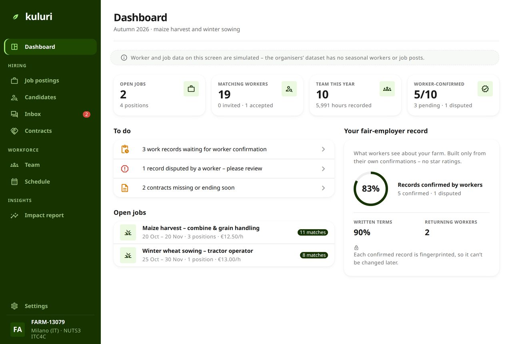
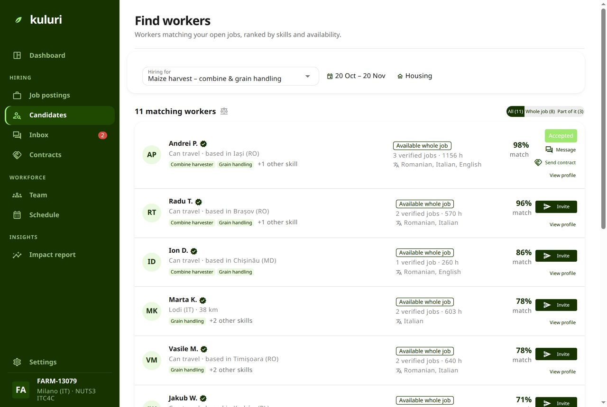
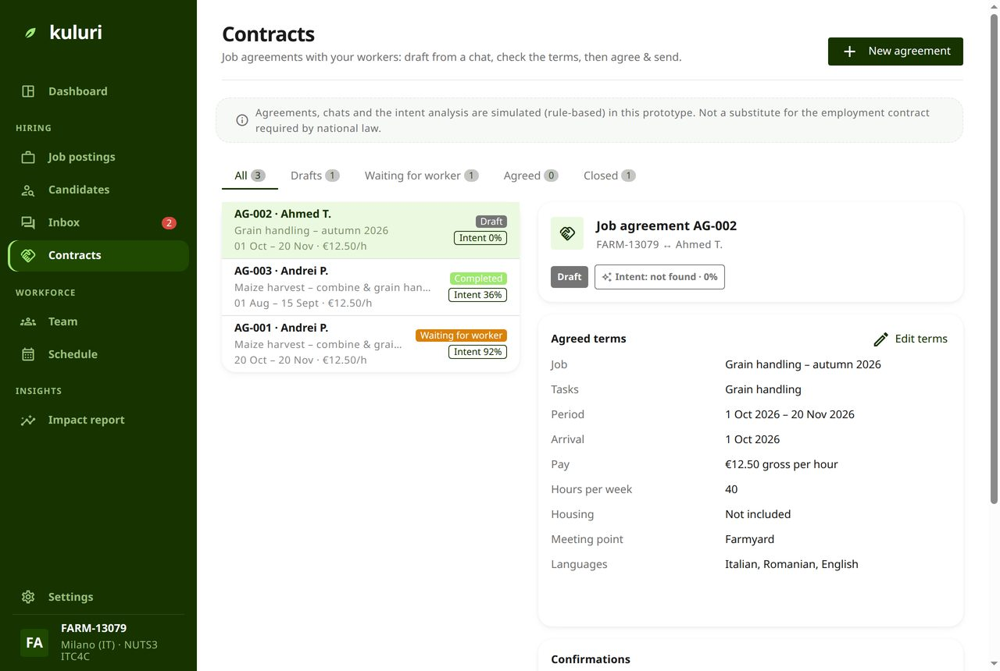
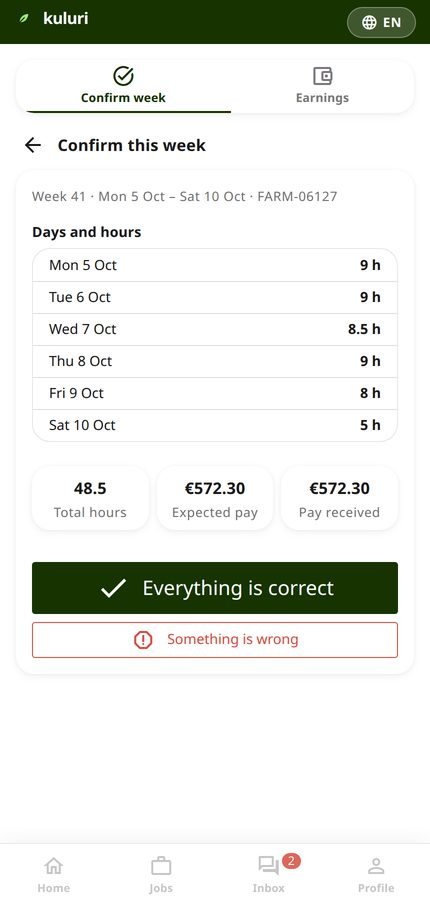
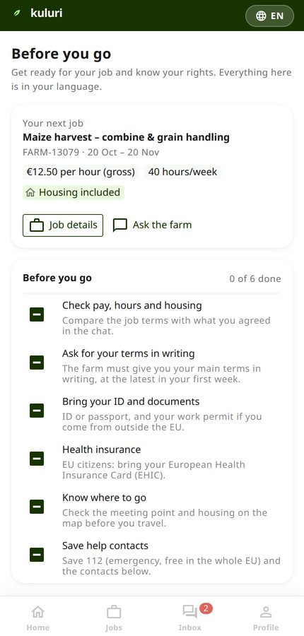
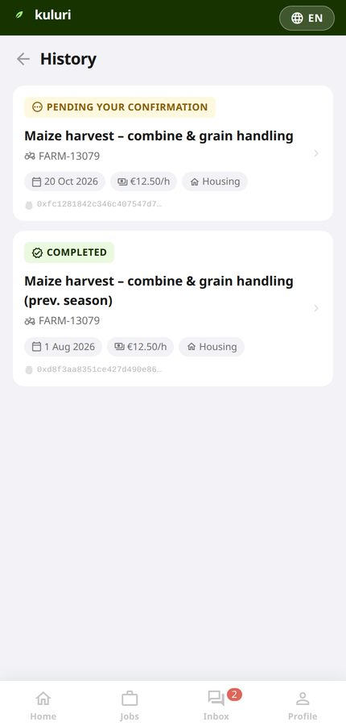

**Record once, share with control.**

Team 27 – Kuluri, EU Agri-Hackathon 2026, Challenge 3 "Flowing data, empowered collaboration".

<strong><a href="demo/">Open the working demo →</a></strong> 
No sign-up: any email address and any code will let you in. Choose <strong>Farm employer</strong>
for the farmer side, <strong>Seasonal worker</strong> for the worker app.

---

## The problem

Buyers and public administrations increasingly ask farmers to prove fair working conditions, and since 2025 CAP payments depend on it. But the work that happens at harvest is the work nobody logs.

We found that in the organisers' own data. The demo farm — **FARM-13079, 371 hectares near Milano** — records 9,517 hours of labour across eight people, and **not one of them is a seasonal worker**. Two thirds of its thirty sales carry no date-valid certificate at the moment of sale, and the proof has to reach 22 different buyers. [The full data story is in DATA.md](https://github.com/lindangulopez/kuluri-site/blob/main/DATA.md).

So farmers repeat the same information for every buyer and every authority, and workers have no record of their own at all.

## What Kuluri does

Three things, in order: **find**, **agree**, **hold**.

### 1. The farmer sees their season in one place

Open jobs, who is matched, which records are waiting for a worker to confirm them, and a fair-employer record built only from the workers' own confirmations — no star ratings.

### 2. Find — matching on what the job needs

Candidates are ranked on skills, languages, availability and distance. **Never on nationality, age or gender** — that rule is in the code, not just in the pitch.

### 3. Agree — the terms, before anyone travels

Pay, hours, dates, housing, the meeting point, the languages spoken on the farm. Drafted from the job and the chat, then checked by a human and sent. An agreement in Kuluri records the agreed terms and the intention to work together; **it is not a substitute for the employment contract national law requires**.

### 4. Hold — the worker confirms their own week

This is the part that makes the record worth something. The worker sees the days, the hours and the pay in their own language, and either confirms them or says something is wrong. Each confirmation is fingerprinted with SHA-256, so it cannot be quietly changed afterwards.

### 5. The worker keeps their rights and their history

Before they travel: what to check, what to bring, and their rights in the EU — written from Directive (EU) 2019/1152, Regulation (EU) 492/2011, Directive 2014/36/EU and Directive 89/391/EEC. Afterwards: a work history that is theirs, exportable as a PDF, which is a CV a farm cannot take away.

### 6. Report — answer buyers and authorities from the same evidence

Buyers' requests and public-administration reports are filled in from those confirmations, with **totals only, never personal data**. The farmer decides which buyer sees what.

---

## Honest about what this is

A prototype, built in one weekend on the organisers' synthetic dataset. No real personal data.

- **From the dataset**: the farm, its parcels, inputs, certificate, sales and regular workers' hours.
- **Simulated**: job posts, the worker pool, chats, agreements and confirmations — the dataset has none of these. The app says so on the screens where it matters.
- **Real**: the SHA-256 fingerprints, and the anchoring contracts deployed on the Polygon Amoy testnet. The app does not call them yet, so anchoring from the Confirm screen is still simulated.
- **AI**: assistants helped us scope Kuluri, build the prototype and produce the deck; every output was reviewed and is owned by a named team member. **No AI model runs inside the product** — the agreement drafting is rule-based so it can be audited.

Both statements in full: [DATA.md](https://github.com/lindangulopez/kuluri-site/blob/main/DATA.md).

## Links

- **[The demo](demo/)** · [app code and how to run it](https://github.com/lindangulopez/kuluri-site#run-it-on-your-computer) · [the pitch deck](https://github.com/lindangulopez/kuluri-site/tree/main/deck)
- [Terms of use](terms/): Kuluri is not a party to the agreements and does not guarantee that they are respected
- [How to contribute](https://github.com/lindangulopez/kuluri-site/blob/main/CONTRIBUTING.md) · [Authors](https://github.com/lindangulopez/kuluri-site/blob/main/AUTHORS.md) · [Cite](https://github.com/lindangulopez/kuluri-site/blob/main/CITATION.cff)

Code: [MIT](https://github.com/lindangulopez/kuluri-site/blob/main/app/LICENSE). Text, screenshots and diagrams on this site: [CC BY 4.0](https://github.com/lindangulopez/kuluri-site/blob/main/LICENSE).
